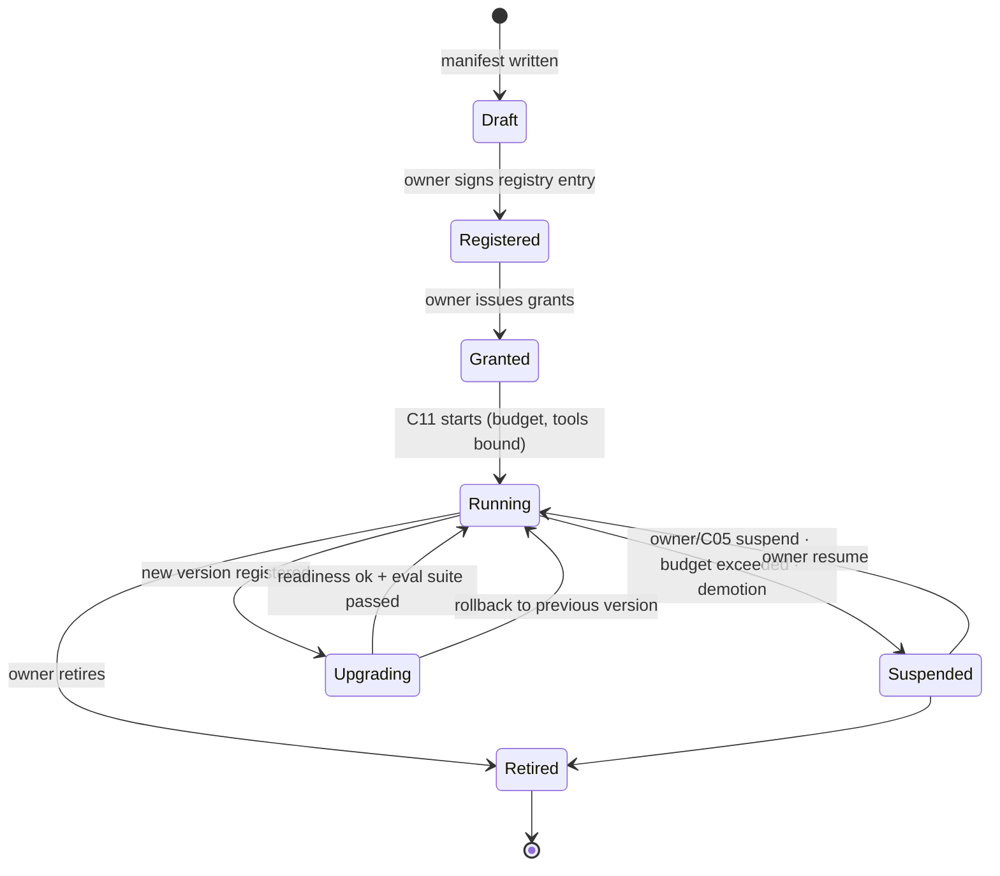

# Agent Model

**Status:** Draft 0.1 · 2026-11-06

## 1. What an agent is in Autonomy

An agent is a registered component (`agent:<name>`) that **observes, reasons and proposes** for one or more responsibilities. It has its own identity, manifest, memory and budget. It never executes consequential actions itself.

There is no universal agent. Each agent is narrow, owns a responsibility, and is replaceable.

| Property | Rule |
|---|---|
| Identity | Ed25519 key, registry entry, manifest (`kind: agent`) |
| Responsibility | Declared in manifest; grants attach to it |
| Trust class | `trusted-input` (reads only registered components' data) or `quarantined` (reads any untrusted content) |
| Tools | R0 read tools bound directly; R1+ only as proposal tools via C06's MCP facade |
| Memory | Own store (`data.owns`) or a private C15 space; never another agent's |
| Budget | Tokens/day, wall-clock per run, proposals/day, cost/month; enforced by C11 and C12 |
| Configuration | Prompt, model routing, tool list and thresholds in versioned files; hash recorded in every proposal |
| Communication | Only via envelopes on C09 topics or delegated jobs (C07); no direct sockets between agents |

## 2. Lifecycle



Upgrade gate: a new agent version (code, prompt, or model route) must pass its **evaluation suite** (golden scenarios with expected proposals or expected "no action") before the registry entry is switched. Results are stored with the version.

## 3. Agent loop and prompt-injection containment

Two patterns are permitted, chosen by trust class [R: Beurer-Kellner et al. 2025 design patterns; CaMeL]:

| Pattern | Used by | How |
|---|---|---|
| **Plan-then-execute with trusted inputs** | `trusted-input` agents that propose actions (A01, A02) | The agent reads only trusted observations and facts. Free text from outside (owner messages excepted) never enters its context. Its output is a structured `Plan`. |
| **Quarantined reader** | `quarantined` agents (A03) and any sub-step that reads untrusted content | No R1+ tools at all. Output is data tagged `trust: untrusted` (summaries, extracted facts). A privileged agent may *use* these values only as data, and any action that depends on them is forced to `require_approval` by policy (GOV-007) |

Additional rules:
- Tool outputs are data, not instructions (also a `jarvis` design rule [V]). The Agent Host wraps them in typed fields, never concatenates them into the system prompt.
- Agents may not change their own prompt, tools, grants, budgets or memory retention (GOV-024).
- Owner messages arrive with `trust: owner`; other people's messages (Telegram group members other than operators, emails) are `untrusted`.

## 4. Plan contract

```json
{
  "plan_id": "pln_…", "agent": "agent:field-station", "agent_version": "0.5.0", "config_hash": "sha256:…",
  "objective": "obj_irrigation_tuning",
  "assessment": {"summary": "Tree row drying faster than learned band; ET0 above baseline.", "confidence": 0.7},
  "steps": [
    {"proposal_id": "prp_1", "depends_on": [], "action": "ha.helper.set", "risk_class_hint": "R1"},
    {"proposal_id": "prp_2", "depends_on": ["prp_1"], "action": "notify.owner", "risk_class_hint": "R1"}
  ],
  "replan_on": ["verification.contradicted", "decision.deny", "input.stale"],
  "valid_until": "2026-11-07T06:00:00Z"
}
```

Replanning is triggered by the listed events; a replan creates a new `plan_id` with `supersedes`. Plans expire; stale plans are never executed.

## 5. Delegation

An agent that needs another agent's capability submits a job (C07) of type `agent.task` addressed to a capability (`research.summarise@1`), not to an agent. Delegation is itself an action (`agent.delegate`, R0 or R1) checked by policy, so a quarantined agent cannot delegate work to a privileged one to launder untrusted content: the job inherits `input_trust: untrusted` and the receiving agent's proposals inherit the taint.

## 6. Memory types per agent

| Type | Where | Retention | Example |
|---|---|---|---|
| Working context | Process memory | Run | Current observations |
| Episodic memory | Agent's own store | Configurable (default 365 d) | "On 2026-11-06 I proposed 118 % and soil confirmed" |
| Semantic knowledge | C15 space `agent:<id>` (private) or `shared` (write needs grant) | Per space | Learned dry-down curve per probe |
| Operational state | Owner component (C07/C06/HA) — referenced, not copied | Owner's policy | Zone states, job states |

## 7. Specialized agents

### A01 Field Station Agent (refactor of `farm_agent`)

| Item | Design |
|---|---|
| Responsibilities | `farm.monitoring` (A3 target), `irrigation.recommendation` (A1 → A2), `farm.reporting` (A3) |
| Inputs | HA observations via C20 (allowlist from `farm/farm_core.yaml` [V]), ET₀ and quality flags from HA packages, power readings, C15 farm space |
| Outputs | Daily assessment event; answers to owner questions (HA Assist, Telegram); proposals: `ha.helper.set` on recommendation helpers, `notify.owner`; later (only after farm Phase 4 commissioning and owner grant) `opensprinkler.water_level.set` within farm design clamps |
| Never | Valve or pump control; anything the farm design marks hardware-only; R3 |
| Model routing | Assessments: local model by default (`privacy: site`), cloud allowed for owner Q&A |
| Fixes from inventory | Send the system prompt; use `role: tool` messages; remove hard-coded allowlist; call HA through the adapter, not the Supervisor token directly |

### A02 Fleet Doctor (from `edge_server` incident agent design)

Runs on a cell other than the patient (P10). Diagnostics are read-only functions from a fixed list; repairs come from a fixed catalog at R1, rate-limited and circuit-broken [V: edge_server design]. Uses `edge_server`'s run limits (turns, minutes, tokens).

### A03 Research Agent

Quarantined. Reads web/YouTube/email content (reusing `knowledge` and `youtube-processor` executors as jobs), evaluates sources, writes facts with provenance into its own C15 space and proposes promotions to `shared` (owner-approved).

## 8. Agent evaluation

| Suite | Content | When |
|---|---|---|
| Golden scenarios | Recorded observation sets with expected plan (or expected no-op) | Every version/prompt/model change |
| Adversarial | Injected instructions in untrusted fields, stale data, conflicting inputs | Every version |
| Live shadow | New version runs read-only next to current one for N days; diff of proposals reviewed | Before promotion to A2+ |
| Outcome metrics | Contradicted verifications, owner rejections, approval latency | Continuous, monthly report |
