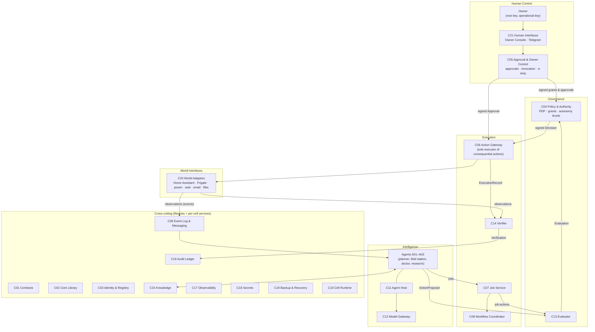
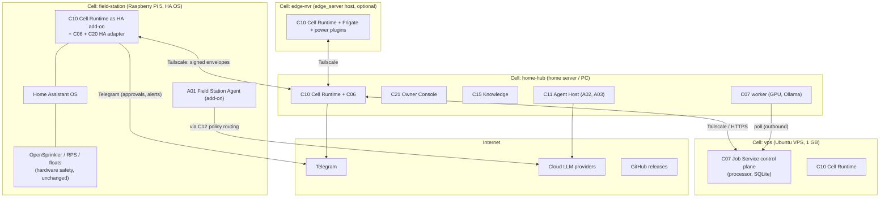

# Autonomy Architecture

**Status:** Draft 0.1 · 2026-11-06 · Evidence tags: see [vision-and-principles.md](vision-and-principles.md#evidence-tags-used-throughout-this-package)

## 1. Summary

Autonomy is a **federation of cells bound by contracts**.

- A **cell** is one machine or site (the Field Station Pi, the home server, the VPS, a GPU PC). Each cell runs a small **Cell Runtime** (C10) that holds the cell's identity, enforces policy locally, executes local actions through its **Action Gateway** (C06), keeps a local event log and audit chain, and forwards to other cells when it can.
- A **hub** is a cell that also hosts shared services — the Job Service (C07), the Owner Console (C21), the Knowledge Service (C15). Losing the hub removes coordination and new intelligence, but **no cell loses safety, local schedules or policy enforcement**.
- **Authority** is not a live service. The owner signs a **registry** (who exists, which keys, which capabilities) and **policy bundles + grants** (who may do what, at which autonomy level). Every cell holds a verified copy and decides locally. Only approvals for gated actions need a round trip to the owner.
- **Intelligence** (agents, planning, LLMs) proposes. **Governance** (policy, evaluation, approval) decides. **Execution** (Action Gateway, jobs) acts. **Verification** observes independently. Each step is a separate component with a separate identity.

This differs from the initial six-plane hypothesis in two ways, justified in §4:
1. Human Control and Governance share one **authority model** (registry, grants, decisions) but are separate components: owners *author and approve*, policy decision points *evaluate*.
2. The Distributed Runtime is not a plane above or below the others; every cell contains a slice of every plane. Planes are logical; cells are physical.

## 2. Gap analysis

What a reliable distributed autonomous system needs [R: sources in research-and-references], compared with what exists [V].

| Capability | Needed for | Exists today | Gap | Addressed by |
|---|---|---|---|---|
| Shared contracts (envelope, manifest, events, jobs, actions) | Independent development that still composes | None — every repo uses ad-hoc JSON | **Missing** | C01 |
| Component/agent identity | Accountability, revocation, signed messages | `edge_server` node Ed25519 keys (implemented) | Generalise from nodes to all components and agents | C02, C03 |
| Registry and enrollment | Discovery, capability declarations | `fleet.yaml` + schema (nodes only) | Extend to components, agents, capabilities, grants | C03 |
| Policy engine and grants | "May do" decisions, autonomy levels | Tier table (design only), `jarvis` permission enum (design) | **Missing** | C04 |
| Independent evaluation | "Should do", risk, preconditions | None | **Missing** | C13 |
| Approval workflow | Human-in-the-loop for gated actions | `edge_server` TOTP flow (design) | Generalise, add web console, revocation | C05 |
| Single execution path for consequential actions | Separation of intelligence and execution | `edge_server` design: "policy check and executor between agent and host helpers" | **Missing in code** | C06 |
| Durable jobs | Long-running work, retries | `processor` (implemented) | Idempotency, tracing, identities, schemas | C07 |
| Durable multi-step workflows with compensation | Partial failure handling | None | **Missing** (start small) | C08 |
| Event log and store-and-forward | Offline operation, sync, audit | `edge_server` outbox/seen store | Generalise to events; per-cell log | C09 |
| Outcome verification | "Did it work" | Farm design: flow meter, soil wet-up (design) | **Missing** as a platform concept | C14 |
| Knowledge with provenance and time | Research, history, learning | None (the `knowledge` repo is a bot) | **Missing** | C15 |
| Agent memory | Persistent agent state | `jarvis` ConversationStore | Per-agent, owned, separable | C15 (private spaces), C11 |
| Model/provider abstraction and routing | Provider independence, local fallback | 4 direct Ollama clients (`jarvis` port out of scope) | One gateway with privacy routing and budgets | C12 |
| Prompt-injection containment | Safe use of untrusted content | None | **Missing** | C11 patterns, C04 taint rules |
| Unified audit trail | Accountability | `processor.audit_log`, planned `edge_server` incidents | One tamper-evident format across cells | C16 |
| Tracing and structured logs | Diagnosis across components | None | **Missing** | C17 |
| Secrets management | Credential isolation | `edge_server` secret store; `.env` elsewhere | Per-cell stores + encrypted config in git | C18 |
| Backup and disaster recovery | Recovery after serious failure | HA backups (planned), `edge_server` archive role (design) | Platform-wide restore procedure and drills | C19 |
| World adapters with scoped access | Safe physical/API interaction | `farm_agent` direct HA calls, `edge_server` plugins | Adapter contract with allowlists and expected-effect probes | C20 |
| Emergency stop | Human control | `edge_server` `/mute`, privileged reboot | Global and per-component suspend that works offline | C05, C06, C10 |
| Agent evaluation/regression testing | Safe model/prompt changes | None | **Missing** | C11, C17 |
| Cost and resource tracking | Budgets | `jarvis` turn metrics (design) | Per-agent token/compute budgets | C12, C17 |

## 3. Logical architecture

### 3.1 Planes and what each owns

| Plane | Owns | Does **not** own | Components |
|---|---|---|---|
| **Human Control** | Owner identity, goals, grants, approvals, revocations, emergency stop, explanations | Evaluating policy at runtime | C05, C21 |
| **Intelligence** | Observing, understanding, planning, proposing; agent memory | Credentials for world-changing actions; authorization | C11, C12, A01–A03 |
| **Governance** | Policy evaluation ("may"), contextual evaluation ("should"), risk classification | Executing anything | C04, C13 |
| **Execution** | Running jobs and actions exactly once, retries, compensation, verification | Deciding whether an action is allowed | C06, C07, C08, C14 |
| **World Interfaces** | Talking to devices, APIs, files, web; scoped credentials | Business logic, authorization | C20 |
| **Cross-cutting** | Contracts, identity, events, knowledge, audit, telemetry, secrets, backup, runtime host | Domain logic | C01–C03, C09, C10, C15–C19 |

### 3.2 The action lifecycle

`Observe → Understand → Plan → Evaluate → Authorize → Execute → Verify → Learn` maps to components as follows. Sequence diagrams are in [governance-and-authority.md](governance-and-authority.md) and [execution-and-workflows.md](execution-and-workflows.md).

| Step | Component | Output contract |
|---|---|---|
| Observe | C20 adapters → C09 | `observation.*` events |
| Understand | Agent (A01…) via C11, C12, C15 | `assessment` (internal), knowledge facts |
| Plan | Agent | `Plan` with `ActionProposal[]` |
| Evaluate | C13 | `Evaluation` (risk class, preconditions, findings) |
| Authorize | C04 (+ C05 if approval required) | signed `Decision` (+ signed `Approval`) |
| Execute | C06 (direct) or C07 (as a job that calls C06) | `ExecutionRecord` |
| Verify | C14 using independent observation via C20 | `Verification` |
| Learn | Agent + C15 (outcome stored with provenance) | `fact` / `lesson` records |

## 4. Why cells and signed authority (instead of a central orchestrator)

| Option | Pros | Cons | Verdict |
|---|---|---|---|
| Central orchestrator (one hub runs agents, policy and execution) | Simple mental model; one database | Hub or link failure stops everything; Field Station on Starlink would lose enforcement and actions; violates P4 and P6 | Rejected |
| Central policy service queried live | Single policy source | Every action needs the hub; offline cells cannot act safely | Rejected |
| **Cells + owner-signed registry and policy bundles, local PDP and gateway** | Works offline; no SPOF; authority is auditable as files; matches `edge_server`'s existing "same fleet.yaml on every node, signed messages" model [V] | Distribution and revocation latency (bundle must reach cells); needs careful versioning | **Adopted** ([ADR-001](adr/ADR-001-cells-with-local-enforcement.md)) |

Revocation latency is bounded by short grant expiries and an owner-signed **revocation notice** that is broadcast and also accepted out-of-band (Telegram → local cell). See [security-and-trust.md](security-and-trust.md#5-revocation).

## 5. Deployment architecture (reference)

**Deployment units** (what actually runs). Many logical components are libraries inside these units, not separate services:

| Unit | Contains | Runs on |
|---|---|---|
| `autonomy-cell` (Python daemon, or HA add-on) | C10 runtime, C06 gateway, C04 PDP (embedded), C09 log + outbox, C16 audit chain, C20 adapters for that cell, C17 exporters | Every cell |
| `processor` control plane (Go) | C07 Job Service, C08 (initially) | VPS or home hub |
| `processor` worker (Go) + executor plugins | C07 data plane, media/LLM executors | GPU PC, home hub |
| Owner Console (web) + Telegram bot | C21, C05 | Home hub (Telegram bot on every cell, as `edge_server` already does) |
| Agent processes | A01 (HA add-on), A02, A03 | Field station, home hub |
| Knowledge Service | C15 | Home hub |
| Libraries | C01 schemas, C02 `autonomy-core` (Python, Go), C12 model gateway (Python) | Imported by all |

No Kubernetes, no message broker and no workflow server in the first stages. Revisit conditions are in the ADRs.

## 6. Integration model (summary)

Full definitions: [component-contracts.md](component-contracts.md).

| Contract | Mandatory for | Purpose |
|---|---|---|
| **Component identity** (Ed25519 key, `component_id`) | All | Signing, accountability |
| **Manifest** (`autonomy.manifest.json`) | All | Capabilities, contracts implemented, dependencies, data owned, health endpoint |
| **Envelope** (CloudEvents 1.0 + Autonomy extensions, signed) | Everything that crosses a component boundary | Provenance, trace, trust level, expiry |
| **Health/readiness** | All long-running components | Liveness, readiness, dependency state |
| **Structured logs + trace context** | All | Diagnosis |
| **Audit records** | Any component that decides or acts | Accountability |
| **ActionProposal / Decision / Approval / ExecutionRecord / Verification** | Agents, C04, C05, C06, C13, C14 | The governed action lifecycle |
| **Job** | Producers and executors of jobs | Durable work |
| **Tool exposure via MCP** | Optional | LLM-facing tool discovery, always behind C06 for consequential tools |
| **A2A** | Optional, deferred | Interop with external agents |

Rules that prevent the failure modes listed in the brief:

| Risk | Rule |
|---|---|
| Circular dependencies | Components depend only on C01/C02 and on *contracts* of others, never on implementations. Dependency graph in [diagrams/component-dependencies.mmd](diagrams/component-dependencies.mmd) is acyclic and checked in CI of the spec repo |
| Direct database coupling | A component's database is private. Others use its API or its events. Conformance test: no component manifest may list another's data store |
| Hidden shared state | Shared state exists only as (a) owner-signed documents (registry, policy) and (b) events. Both are versioned and hashed |
| Incompatible versions | Semantic versioning per contract; manifests declare `contracts: {name: "^1.2"}`; registry rejects incompatible combinations; envelopes carry `dataschema` |
| Uncontrolled inter-agent communication | Agents cannot open connections to each other. They exchange envelopes through C09 topics or delegated jobs, and every delegation is a policy-checked action (`agent.delegate`) |
| Central component as SPOF | Each cell holds registry, policy, PDP, gateway, log; hub services are optional for local operation |
| Everything depending on one orchestrator | No orchestrator. Agents own their plans; C07 runs jobs; C08 is a library pattern over C07 until a server is justified |
