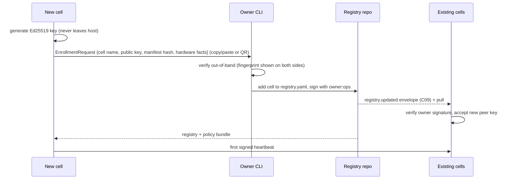

# Distributed Runtime

**Status:** Draft 0.1 · 2026-11-06

## 1. Cells

A **cell** is the unit of deployment, failure and local authority: one machine (or one HA OS box) running the Cell Runtime (C10). Reference cells:

| Cell | Hardware | Packaging | Roles |
|---|---|---|---|
| `field-station` | Raspberry Pi 5, HA OS, Starlink Mini | C10 as HA add-on (planned `edge_server` `ha-addon` packaging [V]) | HA adapter, A01, C06, local Telegram bot |
| `home-hub` | Home server or PC | `host` (Ubuntu, Docker/systemd) | Owner Console, C15, A02/A03, C07 worker, archive |
| `vps` | 1 GB Ubuntu VPS | `host` | C07 control plane (public API), relay of last resort |
| `gpu-pc` | Workstation with GPU | `host` | C07 worker (Ollama, media executors) |
| `edge-nvr` (optional) | `edge_server` host | `host` | Frigate, power plugins |

Two or more cells at two sites are required for "who reports a dead cell" (from `edge_server`: "one node alone works, but nothing can report its own death" [V]).

## 2. Node identity and enrollment



The registry document generalises `fleet.yaml` [V]: it keeps `fleet.yaml`'s sites, nodes, roles and alert order, and adds `components`, `agents`, `capabilities` and key fingerprints. `edge_server`'s rule "every heartbeat carries the hash of the fleet file; warn if they differ for 10 minutes" [V] carries over to the registry and policy-bundle hashes.

## 3. Communication

| Path | Use | Security |
|---|---|---|
| Tailscale (WireGuard mesh) [V: used by edge_server, farm] | All cell-to-cell envelopes, bulk sync, archive | Tailscale ACL tags per role; plus envelope signatures (defence in depth) |
| Site LAN | Same-site fallback when Tailscale is down | Envelope signatures |
| Telegram | Owner alerts and approvals, from every cell's bot [V] | Operator ids, private chats, TOTP |
| Outbound HTTPS poll | Workers → Job Service (works through NAT) [V] | Signed requests |

Self-hosting the coordination server (Headscale) is an option for sovereignty; it removes the dependency on Tailscale's hosted control plane for new connections [R]. Existing Tailscale connections keep working briefly if the control plane is unreachable [A]. Decision deferred ([risks](risks-and-open-questions.md)).

## 4. Offline operation and partitions

| Capability during WAN loss | Field Station behaviour |
|---|---|
| Hardware safety, OpenSprinkler programs | Unaffected (farm design layers [V]) |
| Observation (HA, sensors) | Continues; C09 log grows locally |
| Policy decisions | Local PDP with last bundle; grants still valid until expiry |
| R1 actions within grants | Continue (e.g. helper writes) |
| R2 needing approval | Telegram unreachable → wait until expiry, then close; nothing executes |
| Agent intelligence | A01 falls back to local model or rule-based summary; cloud-only tasks skipped |
| Alerts | Queued; summary when link returns (as `edge_server` does for Telegram outages [V]) |
| Revocations | Not received until reconnect → bounded by grant expiry (default ≤ 30 d; R2 grants ≤ 7 d) |

**Long partition (days):** grants close to expiry are not renewed automatically; when a grant expires offline, the corresponding agent drops to A1 (recommend-only). Stored schedules in OpenSprinkler continue regardless (fail toward watering, per farm design D9 [V]).

**Clocks:** cells use NTP when online and keep RTC/HA time offline; envelope freshness uses ±5 min skew and per-sender sequence numbers so a drifting clock delays rather than corrupts.

## 5. Synchronisation

- Per producer: monotonic `seq` (persisted, survives restarts [V: edge_server Counter]).
- Each cell tracks, per peer and per producer, the highest contiguous `seq` acknowledged.
- `POST /v1/sync` exchanges batches (signed), resumable, filtered by `privacy` (e.g. `private` topics never leave the cell; `site` topics go only to the home hub).
- Conflicts: there are none by construction — state has a single owner; events are facts. A cell never writes another cell's operational state; it sends a command (an action request) to that cell's gateway.
- Audit chains are per cell and copied, never merged.

## 6. Workload placement

Placement is declarative and done by the Job Service (jobs) or by addressing (actions go to the gateway of the cell that owns the resource):

```yaml
placement:
  job_types:
    vision.describe_frames: {requires: [gpu, ollama], prefer: [gpu-pc], fallback: [home-hub]}
    audio.transcribe:       {requires: [ffmpeg], prefer: [gpu-pc, home-hub]}
    farm.daily_report:      {requires: [cell:field-station]}      # local data, local_only
  resources:
    "ha:field-station/*":   {gateway: svc:action-gateway@field-station}
    "relay:site-a/*":       {gateway: svc:action-gateway@edge-nvr, owner_only: true}   # one owner per relay [V]
```

## 7. Health and failure detection

Reuse `edge_server` mechanisms [V]: 60 s signed heartbeats, 5-min suspicion, multi-path checks (Tailscale, LAN, Telegram), alert by first healthy node in `alert_order`, announced outages before planned power-down. Extend heartbeat payload with `registry_hash`, `policy_bundle`, `hold_mode`, pending approvals count.

## 8. Deployment and upgrades

| Packaging | Mechanism |
|---|---|
| `host` | `edge_server` deploy script fleet mode; only green-CI release tags [V] |
| `ha-addon` | Add-on image pinned to a release tag [V]; HA backup taken before update |
| Job Service, workers | Go binaries via systemd units (existing [V]) |

Rolling upgrade: one cell at a time; readiness must pass within 5 min or automatic rollback; upgrades blocked below power stage `normal` [V].

## 9. Backup and disaster recovery

See [observability-and-operations.md §5](observability-and-operations.md#5-backup-and-recovery). Key point: the authority root (owner root key) is offline and backed up on paper/hardware key; everything else is reproducible from the registry repo, policy repo, backups and release tags.
