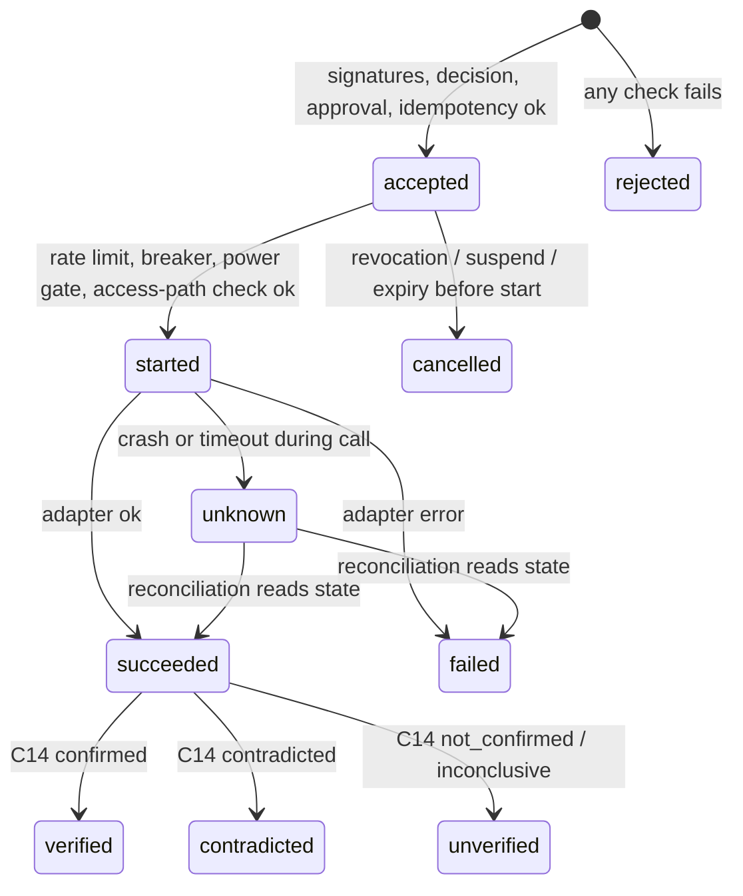
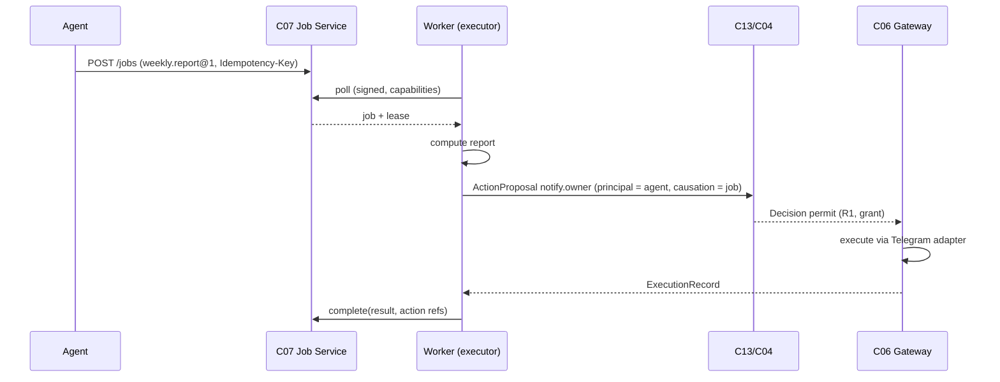

# Execution and Workflows

**Status:** Draft 0.1 · 2026-11-06

## 1. Three kinds of work

| Kind | Component | Example | Durability | World-changing? |
|---|---|---|---|---|
| **Job** | C07 Job Service | transcribe a video, compute a weekly report, run an agent task | Durable queue, retries | No — may *request* actions |
| **Action** | C06 Action Gateway | set a helper, restart a service, set OpenSprinkler water level | Durable record, idempotent | Yes |
| **Workflow** | C08 over C07 + C06 | archive → verify → prune; multi-zone commissioning test | Durable step state, compensation | Through its actions |

Jobs and actions are deliberately different: jobs are about *compute*; actions are about *authority*. A job that wants to change the world submits an `ActionRequest` and waits for its decision like an agent does.

## 2. Job Service (refactor of `processor`)

What exists [V]: SQLite WAL queue; statuses `queued → leased → running → succeeded | failed | dead_letter`; priority; lease expiry and heartbeat; retries with exponential backoff; DLQ; worker poll API with `capabilities[]`; HMAC-signed webhooks; audit log; API keys.

Changes, in order (each is a small, testable increment):

| # | Change | Why | Compatibility |
|---|---|---|---|
| J1 | `Idempotency-Key` on `POST /jobs` (unique per principal) | Exactly-once submission across retries/partitions | Additive |
| J2 | `traceparent`, `correlationid` columns and propagation to worker and executor | One trace per story | Additive |
| J3 | `job_type@version` with registered JSON Schemas for input/result; reject unknown | Typed contracts between independently developed producers and executors | Additive (old types grandfathered as `@0`) |
| J4 | Principals: `submitted_by` = component id (not only human user); per-worker Ed25519 identity, signed poll requests | Accountability; replaces shared worker token | Worker protocol v2 alongside v1 |
| J5 | `input_trust` and `privacy` on jobs; placement honours `privacy: local_only` | Taint and data boundaries | Additive |
| J6 | `POST /jobs/{id}/cancel`, cooperative cancellation via heartbeat response | Revocation and suspension | Additive |
| J7 | Publish `job.*` envelopes to C09 (outbox) | Integration without DB coupling | Additive |
| J8 | Scheduled jobs (cron expressions) | Replace per-repo schedulers (`yt_sync`, `leadgen` APScheduler) when they opt in | Additive |
| J9 | CI with unit + integration + conformance tests | No CI today | — |

Executor interface (Go, extends existing `Executor` [V]):

```go
type Executor interface {
    Type() string            // "video.frames"
    Version() string         // "1.2"
    InputSchema() []byte
    ResultSchema() []byte
    Execute(ctx context.Context, job JobContext, input json.RawMessage) (json.RawMessage, error)
}

type JobContext struct {
    JobID, IdempotencyKey, CorrelationID, TraceParent string
    Principal string
    InputTrust string            // "trusted" | "untrusted"
    Attempt, MaxAttempts int
    Deadline time.Time
    RequestAction func(ctx context.Context, req ActionRequest) (ActionHandle, error) // goes to C06
}
```

Python executors (media group) run as subprocess executors behind a Go shim or as a Python worker implementing the same worker API v2. The worker API, not the language, is the contract.

## 3. Action Gateway execution semantics



Rules:
- **Exactly-once intent, at-least-once delivery.** `action_id` and `idempotency_key` are unique. A second request with the same key returns the existing record; a second request with the same key but different `params_hash` → `conflict.idempotency_mismatch`.
- **No blind retries.** Retry only if the adapter declares the operation idempotent (`set value`) — never for non-idempotent ones (`run zone for 10 min`) without reconciliation.
- **Reconciliation after crash.** On restart, `started` records go to `unknown`, then the adapter's `read_state` decides. If it cannot decide, escalate to the owner.
- **Timeouts.** Per adapter operation; exceeding → `unknown` (not `failed`).
- **Never cut your own access** [V: edge_server]: actions tagged `affects_access` are refused unless another access path is confirmed working.
- **Rate limits and breakers** [V: edge_server]: default 3 automatic actions per target per hour, 10 per day per cell; same problem twice in 24 h opens the breaker for that action type.

## 4. Partial failure and compensation

Workflows declare steps with optional `compensate` actions:

```yaml
workflow: media.archive_and_prune
version: 1
steps:
  - id: copy
    job: archive.copy@1
    compensate: archive.delete_copy@1
  - id: verify
    job: archive.verify_checksums@1
  - id: prune
    action: storage.prune_source        # R2: needs decision
    requires: [verify]
    compensate: null                    # irreversible → must come last, after verification
```

Rules:
- Irreversible steps must come after every check that can fail.
- On failure at step *k*, compensations for completed steps run in reverse order; each compensation is itself a job/action with its own record.
- A compensation that fails puts the workflow in `needs_owner`, never silently ignored.
- Workflows waiting on approval sleep (no worker held); approvals expire; expired → compensate.

### Initial implementation ([ADR-006](adr/ADR-006-extend-processor-defer-workflow-engine.md))

Two tables in the Job Service (`workflows`, `workflow_steps`) and a coordinator executor that advances workflows when step jobs or actions complete (driven by `job.*`/`action.*` events). This covers the expected scale (tens of workflows per day).

Revisit and adopt a durable-execution engine when any holds: workflows with > 10 steps or loops are common; versioning of in-flight workflows becomes painful; > 1,000 workflow executions/day; need for timers longer than weeks at volume. Candidates: DBOS (library, Postgres-backed, MIT, no separate server) or Temporal (server + database, most mature) [R].

## 5. Scheduling and placement

| Concern | Rule |
|---|---|
| Where a job runs | Worker capabilities (`gpu`, `ollama`, `ffmpeg`, `cell:field-station`) must cover `requires`; `privacy: local_only` jobs run only on the originating cell's worker |
| Priority | Existing priority weight [V]; owner-initiated > safety/incident > scheduled > background |
| Resource limits | Workers declare concurrency per job type; power stage gates (`conserve` and below: only power/safety jobs, as in `edge_server` [V]) |
| Long-running jobs | Heartbeats extend leases [V]; progress events every N seconds; cancellation via heartbeat response |
| Timeouts | Per job type default, overridable per job |
| Dependencies | Only through workflows; plain jobs are independent |

## 6. Sequence: a job that needs an action


