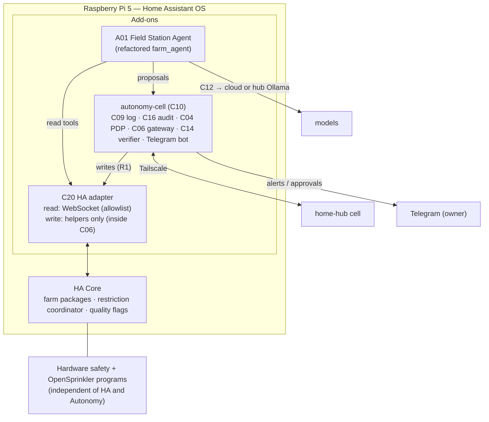

# Field Station Reference Deployment

**Status:** Draft 0.1 · 2026-11-06 · Site design: [`farm_automation/docs/architecture.md`](https://github.com/realsystem/farm_automation/blob/main/docs/architecture.md) (farm architecture v1.2)

The Field Station is the proving ground for the architecture, not its definition. It exercises every plane on constrained, remote, solar-powered hardware with a satellite link.

## 1. Current environment

| Element | Status | Source |
|---|---|---|
| Raspberry Pi 5, Home Assistant OS | Operational | Brief; farm architecture [V] |
| Tailscale remote access | Configured | Brief; farm architecture [V] |
| Starlink Mini | Available; only WAN | Brief |
| Reolink PoE camera | Present | Brief |
| Farm Agent add-on | Present; has known defects (see inventory) | Brief; `farm_agent` [V] |
| Victron SmartShunt, ECO-WORTHY equipment, solar charge controller | Present; entities `sensor.smartshunt_*`, `sensor.eco_worthy_*` used by `farm_agent` | Brief; `farm_agent` allowlist [V] |
| Water storage (500 gal), RPS 800V pump, multi-zone irrigation | Present; topology to be confirmed | Farm architecture [V] |
| OpenSprinkler | Present, **not tested** | Brief; farm Phase 1 [V] |
| Ecowitt WS90/GW2000/WH51 | Planned (farm Phase 2) | Farm architecture [V] |

Untested hardware is treated as non-operational. Nothing in Autonomy depends on OpenSprinkler until farm Phase 4 exit criteria are met.

## 2. What must not change

- The working Home Assistant configuration. Autonomy installs as **add-ons only**; it does not edit `configuration.yaml`, packages or automations. Farm packages are owned by the `farm_automation` repo and its own phases.
- Physical safety layers and the farm restriction coordinator. Autonomy writes only to helpers that HA automations already validate and clamp.
- No restarts of HA Core by Autonomy in Stages 3a–3c. Add-on installation restarts only the add-on.

**Recovery plan for every install step:** take an HA full backup first (off-site via Tailscale per farm §10 [V]); rollback = stop and uninstall the add-on; if HA itself misbehaves, restore the backup. Steps are done on a site-visit week when possible.

## 3. Cell layout

Two add-ons rather than one keeps the agent (proposer) separate from the gateway (executor), so the agent never has write credentials (GOV-002).

## 4. Incremental integration

| Step | Stage | What happens | Autonomy level | Exit criteria |
|---|---|---|---|---|
| **1 Read-only** | M10 | `autonomy-cell` add-on reads HA via WebSocket; publishes `observation.*`; heartbeats to hub; no write credential exists anywhere in Autonomy | A1 (observe) | 14 days stable; HA unaffected; RAM ≤ 300 MB |
| **2 Analysis & recommendations** | M11 | A01 produces daily assessment and answers questions (Telegram, HA Assist); text only | A1 | Owner rates ≥ 80 % useful; zero fabricated values (all values traced to observations) |
| **3 Proposed plans** | M12 | A01 submits proposals; C13 evaluates, C04 decides in `dry_run`; owner sees "would do" | A1 | ≥ 95 % proposals pass deterministic checks; no R2/R3 proposals |
| **4 Limited execution** | M13 | Grant (A2): `ha.helper.set` on `input_number.farm_irrigation_recommended_climate_factor` and `input_text.farm_agent_daily_note` (two new helpers, added through the farm repo's irrigation package, not by Autonomy); each change owner-approved by Telegram; executed by C06 | A2 | 30 days, every action with full audit chain, 0 unexplained |
| **5 Verification & learning** | M13 → M13b | C14 verifies helper writes (state) and, after farm Phase 4, downstream effects (flow volume on next run, soil wet-up per learned band); A01 records outcomes | A2 → A3 for helper writes | Contradicted verifications = 0 for 30 days to promote |

The farm design already keeps the climate factor as a *recommendation* until farm Phase 6 [V]. Autonomy's first real action is therefore writing the **recommended** value that HA displays next to the applied one — useful, reversible, and harmless — which exercises the full governed path before anything physical is touched.

## 5. Responsibilities and autonomy levels at the Field Station

| Responsibility | Resource | Risk | Initial | Target | Notes |
|---|---|---|---|---|---|
| Monitoring & alerts | All farm sensors (read) | R0 | A1 | A3 | Alerts via cell bot; deterministic thresholds stay in HA |
| Daily assessment & Q&A | Read + Telegram | R1 | A1 | A3 | Notifications to owner are R1 |
| Recommended climate factor | Helper | R1 | A2 | A3 | Bounded by farm clamps |
| Applied climate factor (OpenSprinkler water level via coordinator) | Controller setting | R2 | — | A2 → A4 (bounded) | Only after farm Phase 4 and 6 gates [V]; numeric bounds = farm clamps; independent verification by flow meter |
| Manual zone run | Valve via OpenSprinkler | R2 | — | A2 | Owner-approved one-off runs only |
| Restriction (manual pause / maintenance) | Controller enable | R2 | A0 | A0 | Human-only by farm design [V] |
| Pump, RPS, floats, master valve wiring | Hardware | R3 | A0 | A0 | Never remote |
| HA restart, add-on restart | Supervisor | R1/R2 | A0 | A2 | Via A02 Fleet Doctor from another cell |
| Camera | Reolink | R0 | A1 | A1 | `privacy: private`; snapshots only to owner |

## 6. Demonstrating each required capability

| Capability (brief §9) | Where demonstrated |
|---|---|
| Local and remote observation | Step 1; owner console on hub and Telegram |
| Environmental data collection | Ecowitt sensors via HA (farm Phase 2) → C09 |
| Knowledge and historical analysis | HA long-term statistics + weekly export [V] → A01 memory/C15 farm space: drying rates, ET₀ history |
| Goal-based planning | Objective `obj_irrigation_tuning` → plans |
| Independent evaluation and authorization | C13 deterministic checks + Cedar PDP + owner approval |
| Controlled execution | C06 only, rate-limited, power-gated |
| Outcome verification | C14 state check; later flow/soil independent checks |
| Offline operation | M15 7-day drill |
| Recovery and synchronization | C09 sync after drill; HA backup/restore runbook |

## 7. Safety boundary

No basic safety mechanism depends on an LLM, the hub, the internet or Autonomy at all. If every Autonomy add-on is stopped, the farm behaves exactly as the farm architecture specifies.
