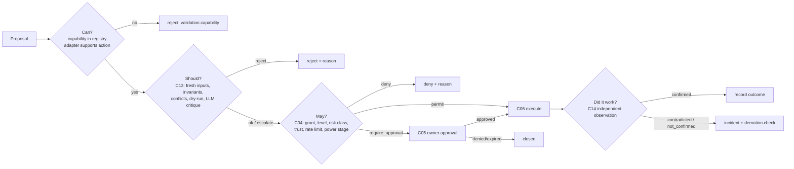
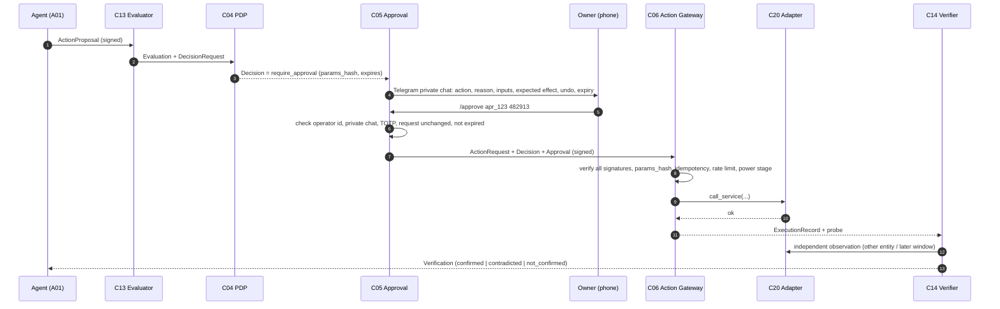

# Governance and Authority

**Status:** Draft 0.1 · 2026-11-06 · Contracts: [component-contracts.md §8](component-contracts.md#8-action-lifecycle-contracts)

## 1. Separation of powers

| Function | Component | Identity | Holds |
|---|---|---|---|
| Propose | Agents (via C11) | `agent:*` | Read credentials only |
| Evaluate ("should") | C13 Evaluator | `svc:evaluator@<cell>` | Nothing that acts |
| Authorize ("may") | C04 PDP | `svc:pdp@<cell>` | Policy bundle, grants |
| Approve (owner) | C05 + owner | `owner:ops` | Owner operational key, TOTP secrets |
| Execute | C06 Action Gateway | `svc:action-gateway@<cell>` | Write credentials for adapters |
| Verify ("did it work") | C14 Verifier | `svc:verifier@<cell>` | Read credentials, independent paths |

Five identities, five signatures per consequential action. Compromising one does not grant the others.

## 2. Autonomy levels

| Level | Name | System does | Human does | Typical grant |
|---|---|---|---|---|
| **A0** | Manual | Records, reminds | Everything | none |
| **A1** | Assisted | Observes, analyses, recommends | Decides and acts | R0 only |
| **A2** | Delegated | Executes the specific actions the owner approves | Approves each R1/R2 action | R0 + approvals |
| **A3** | Supervised | Executes routine R1 actions within bounds; escalates exceptions and every R2 | Reviews summaries, handles escalations | R1 bounded |
| **A4** | Bounded | Manages a responsibility end to end within explicit bounds, including specific R2 actions | Sets bounds, audits periodically | R1 + listed R2 with numeric bounds |
| **A5** | Adaptive | Also adapts strategies and proposes new bounds | Approves bound changes | Never self-applied; bound changes are always A2 |

Levels attach to **(responsibility, resource set, risk class)**. The same agent can be A4 for "farm monitoring alerts" and A1 for "irrigation runtimes".

Promotion rules (owner decides; the system supplies evidence):

| From → To | Evidence required |
|---|---|
| A1 → A2 | 14 days of recommendations reviewed, ≥ 90 % judged correct by owner |
| A2 → A3 | 30 days of approved actions with 0 contradicted verifications and 0 rollbacks |
| A3 → A4 | 90 days at A3, bounds defined numerically, an independent verification path exists |
| Any → lower | Automatic on: one contradicted verification for R2, two for R1 within 30 days, any policy violation attempt, owner challenge |

## 3. Can / May / Should / Did



## 4. Policy engine

**Choice: Cedar, embedded** ([ADR-004](adr/ADR-004-cedar-embedded-pdp.md), provisional).

| Option | For | Against |
|---|---|---|
| **Cedar** (embedded via `cedar-go` / `cedarpy`) | Purpose-built for application authorization (principal/action/resource/context); deny-by-default; designed for automated analysis; small, embeddable [R] | Smaller ecosystem; Python binding is community-maintained [A] |
| OPA / Rego | CNCF, large ecosystem, WASM [R] | General-purpose logic language, harder to read and verify for a single owner; Go daemon adds a process per cell |
| OpenFGA / Zanzibar-style | Great for relationship graphs | Overkill: one owner, few principals |
| Hand-written rules in code | No dependency | Not analysable, policy changes need deploys, hard to audit |

### Example policies (Cedar)

```cedar
// R0: read-only observation is allowed for components granted the responsibility.
permit (principal, action == Action::"ha.state.read", resource)
when { context.grant.responsibility == resource.responsibility };

// R1 helper writes for the Field Station agent, bounded by grant constraints.
permit (principal == Agent::"field-station", action == Action::"ha.helper.set", resource in Group::"farm_helpers")
when {
  context.risk_class == "R1" &&
  context.evaluation == "ok" &&
  context.trust == "trusted" &&
  context.params.value >= context.grant.constraints.value_range.min &&
  context.params.value <= context.grant.constraints.value_range.max &&
  context.count_today < context.grant.constraints.max_per_day &&
  context.power_stage == "normal"
};

// Anything derived from untrusted input that changes the world needs an owner.
forbid (principal, action, resource)
when { context.trust == "untrusted" && context.risk_class != "R0" }
unless { context has approval && context.approval.valid };

// R3 is never remote.
forbid (principal, action, resource) when { context.risk_class == "R3" };
```

`require_approval` is produced by a wrapper: if no `permit` matches but a policy annotated `@approvable` would match with a valid approval in context, the PDP returns `require_approval` instead of `deny`.

### Policy bundles

- Stored in the owner's private config repo, compiled and validated in CI (Cedar validator against the schema), signed by `owner:ops`, versioned `YYYY.MM.DD-n`.
- Distributed to each cell via C09 (`authority.bundle_published`) and also pullable from the hub.
- A cell refuses bundles with lower version than the active one (no rollback without root signature).

## 5. Evaluator (C13) — independent review without false independence

Order of checks; the first failing **deterministic** check decides:

1. **Schema and capability**: proposal valid; action exists in adapter's declared operations.
2. **Freshness**: every input younger than `freshness_s`; data-quality flags `valid` (reuses Field Station quality layer [V: farm_automation §9.9]).
3. **Invariants**: domain rules declared by the adapter or policy (e.g. water-level clamp 30–200 %, step ≤ 25 %/day [V: farm_automation §8]).
4. **Conflicts**: other pending or recent actions on the same resource; contradictory objectives.
5. **Dry-run**: if adapter supports `simulate`, compare predicted effect with `expected_effect`.
6. **Independent LLM critique** (optional, advisory): a *different* model family from the proposer where possible, given only the structured proposal and the trusted inputs — never raw untrusted content. It may return `concern` with reasons → outcome becomes `escalate`. It can never turn a failed check into `ok`.

Why not panels of LLMs voting: a 2026 study found nine LLM judges carried about two independent votes' worth of information because their errors correlate, and the best single judge matched or beat the panel [R]. Deterministic checks and owner approval provide real independence; LLM critique is a cheap extra tripwire.

## 6. Approval flow



Approval UX rules (to avoid approval fatigue, a known weakness of CaMeL-style systems [R]):
- Batch: one daily digest message with N proposals, each approvable separately.
- Show the *diff* (before → after), the undo, and the verification plan, in ≤ 5 lines.
- Track time-to-approve and approve-without-reading signals (approval within 3 s of display) and report them monthly.

## 7. Handling hard cases

| Situation | Handling |
|---|---|
| **Conflicting objectives** | Objectives have owner-set priorities. C13 flags proposals that advance one objective at the expense of a higher one; outcome `escalate` with both objectives shown |
| **Conflicting agents** | Agents never negotiate directly. Two proposals on one resource within the conflict window → both escalated; owner (or a policy rule such as "safety agent wins") decides. Decision recorded as precedent fact in C15 |
| **Uncertain information** | Proposals carry input confidence. Policies can require `min_confidence`; below it → `escalate` |
| **Missing permission** | `deny` with the missing grant named; agent may file a `grant.request` (an R0 event) the owner sees in the console. Agents cannot retry around a deny with a different action name — C13 groups actions by declared effect |
| **Unexpected consequences** | C14 `contradicted` → incident; automatic demotion check; undo proposed (not executed) unless the grant covers undo at A3+ |
| **Failed operation** | C06 records `failed`; retries only for adapters that declare the operation idempotent; otherwise escalate |
| **Partial completion** | C08 compensations; see [execution-and-workflows.md](execution-and-workflows.md#4-partial-failure-and-compensation) |
| **Network disconnection** | Decisions are local; approvals need the owner path (Telegram from the cell, or console via hub). With no owner path, gated actions wait until their expiry, then close |
| **Compromised agent** | Its proposals are still evaluated and policy-checked; it has no write credentials. Revocation removes it from the registry; C06 rejects its pending actions. See [security-and-trust.md](security-and-trust.md) |
| **Human override** | Owner can execute any R0–R2 action directly via console (still through C06, recorded as `owner:ops`); overrides are inputs to agents (they must not re-propose the overridden action for a cool-down period) |
| **Revocation while running** | C05 broadcasts `authority.revoked`; C06 checks revocation list before every adapter call and between steps of multi-call actions; in-flight adapter calls are not interrupted mid-call if interruption is unsafe (adapter declares `cancel_safe`), but no further step starts |

## 8. Emergency controls

| Control | Scope | Mechanism | Works without |
|---|---|---|---|
| `/suspend <agent>` | One agent | C05 signs `system.suspended{scope: agent:x}`; C11 stops it; C06 rejects its actions | Hub (sent via any cell's bot) |
| `/suspend cell <name>` | All automatic actions on a cell | Same, scope `cell:x`; R0 continues | Hub, internet if owner is on the LAN |
| `/stop all` | Everything automatic, everywhere | Root- or ops-signed; every C06 enters `hold` mode: only owner-initiated actions | LLMs, cloud, hub |
| Physical | Field Station | Existing hardware: pump controller inputs, OpenSprinkler enable switch, master valve power (farm design) | Autonomy entirely |

`hold` mode is sticky: it survives restarts and is cleared only by an owner-signed `system.resumed`.
