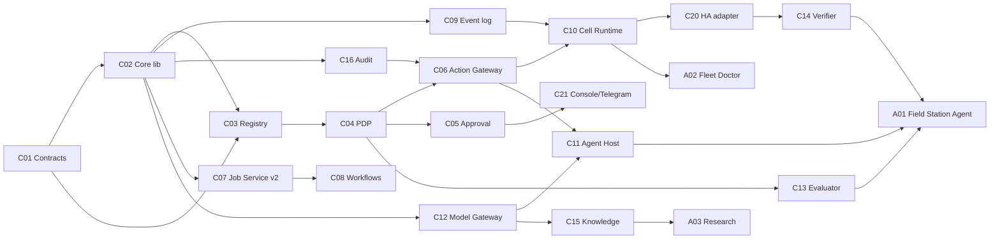

# Integration Strategy — Building Pieces That Form the Whole

**Status:** Draft 0.1 · 2026-11-06

## 1. The smallest stable foundation

Three things must exist before independent tracks can proceed without later rewrites. Everything else can be built in parallel against them.

| Foundation piece | Content | Size | Why it is enough |
|---|---|---|---|
| **C01 `autonomy/spec` v0.1** | Manifest, envelope, health, error, action lifecycle (proposal, evaluation, decision, approval, request, execution, verification), job, audit schemas + conformance CLI | ~15 schemas, fixtures, one CLI | Every component can be written and tested against fixtures alone |
| **C02 `autonomy-core` v0.1** (Python first, Go second) | Keys, canonical JSON, envelope sign/verify, freshness/replay, sequence counter, outbox, audit append | Extracted from `edge_server/controlplane.py` (660 lines [V]) | Every component speaks the envelope identically; cross-language test vectors |
| **C03 registry v0.1** | Registry schema (generalised `fleet.yaml`) + CLI to add/sign/verify | Extends `tools/fleet.py` (993 lines [V]) | Identity and discovery without a service |

Not in the foundation (on purpose): no broker, no workflow engine, no knowledge service, no console. Each later piece plugs into the foundation.

## 2. Dependency graph and parallel tracks

| Track | Can start after | Independent of | Owner repo |
|---|---|---|---|
| T-A Contracts & core lib | — | everything | `autonomy` (`spec/`), `edge_server` |
| T-B Job Service v2 | C01, C02 (Go) | governance | `processor` |
| T-C Governance (PDP, gateway, approval) | C01–C03 | jobs, models | `edge_server` (cell) |
| T-D Model gateway + agent host | C01, C02 | governance (mock decisions) | `autonomy-core` (`models`, `agents`; ADR-017) |
| T-E HA adapter + Field Station cell | C02, C09 | models | `edge_server` ha-addon + `farm_automation` |
| T-F Media executors | C07 v2 worker API | everything else | `youtube-processor`, `tts`, `knowledge` |
| T-G Knowledge service | C01, C02, C12 | governance | new |

T-B, T-C, T-D, T-E and T-F proceed in parallel once T-A is at v0.1.

## 3. Per-block development plan

| Block | Implement independently | Contracts first | Minimum deps | Mock / simulate | Useful standalone release | Integration test proving compatibility | Later consumers | Breaking changes | Upgrades |
|---|---|---|---|---|---|---|---|---|---|
| C01 | All | — | — | — | Schemas + CLI usable in any repo CI | Fixtures validate; compat checker vs previous tag | Everyone | Any MAJOR schema change | Components support current + previous MAJOR 6 months |
| C02 | All | Envelope, audit | C01 | — | `edge_server` uses it for heartbeats (no behaviour change) | Cross-language vectors; `edge_server` test suite green | All | Signature/canonicalisation change | New algorithm id alongside old |
| C03 | All | Registry schema | C01, C02 | Fake cells | Owner CLI signs/verifies fleets + components | Cell rejects unsigned/old registry; accepts new component without code change (ST-01) | C04, C10, C07 | Registry schema MAJOR | Migrate `fleet.yaml` via `--write-config` path [V] |
| C07 | Most | Job, worker v2 | C01, C02 (Go) | Executors `noop/echo` exist [V] | Job Service with idempotency + traces, usable by media apps | Python worker v2 passes conformance; duplicate key returns same job (IT-14) | Agents, C08, apps | Worker API v1 removal | Run v1 and v2 side by side |
| C04 | All | Decision request/decision | C01–C03 | Static fixtures | Library + CLI `autonomy pdp test` for policy authors | Same decision on Python and Go for vector set | C06, C13 | Context schema MAJOR | Bundles versioned; PDP supports bundle schema N and N−1 |
| C06 | Most | Action request, execution record | C02, C04, adapter contract | Mock adapter with fault injection | Gateway on a cell executing R1 helper writes from CLI | Crash-between-call-and-record reconciles to correct state | Agents, C07 jobs, C21 | Action schema MAJOR | Drain pending actions before upgrade |
| C05/C21 | Most | Approval | C04, Telegram | Fake owner | Telegram approvals for `edge_server` gated commands (already designed) | Approval for X cannot authorise X′ (IT-12) | All gated actions | Approval schema | Expire pending approvals at upgrade |
| C09 | All | Envelope, sync | C02 | Two cells on one machine | Event log replacing `edge_server` outbox | 7-day simulated partition: no loss/dup (ST-04) | C10, agents, C15 | Sync protocol MAJOR | Dual-protocol window |
| C10 | Mostly (it hosts others) | Health, cell API | C02, C09; C04/C06 when ready | — | Existing `edge_server` node + new health API | HA add-on survives restart/power cut | All cells | Packaging change | Release tags, rollback |
| C12 | All | Model port | C02 | Fake provider | Library used by the `edge_server` `/ask` agent and the C13 reviewer (A01 later) | `local_only` never egresses (IT-83) | Agents, C13, C15 | Port signature | Adapters versioned |
| C11 | Most | Agent manifest, plan | C12; C06 (mock ok) | Mock gateway returns decisions | Run A01 in read-only mode | Suspend cancels pending actions (ST-08) | Agents | Plan schema | — |
| C13/C14 | All | Evaluation, verification | C04 contract; C20 read | Recorded observations | Evaluator CLI over proposal files | Stale input never `ok`; no-flow → `contradicted` (ST-12) | C04, C06 | Outcome enums | Open enums documented |
| C15 | All | Fact, space | C02, C12 | — | Personal knowledge base usable from CLI | Provenance on every result (IT-40) | A03, A01 | Fact schema | Facts versioned, migrations offline |
| C20 (HA) | All | Adapter contract | C02 | HA dev container (`farm_agent` has one [V]) | Read-only HA observer publishing events | Allowlist enforced (IT-60) | A01, C14 | Operation names | Operations versioned |
| A01 | Most | Agent manifest, plan | C11, C12, C20 | Recorded farm data | Daily assessment in Telegram (read-only) | Golden scenarios pass | Owner | — | Shadow run before promotion |

## 4. Rules that keep pieces coherent

1. **Contract before code.** Any new cross-component interaction starts as a schema PR in `autonomy/spec`.
2. **Conformance in every repo's CI.** A component that fails conformance cannot be released.
3. **No shared databases, no shared code beyond C02.** Copying a helper is allowed; importing another component's internals is not.
4. **Every piece ships with a mock of what it depends on**, so it can be tested alone.
5. **Each release states which contract versions it implements** (manifest) and the registry enforces compatibility.
6. **Prefer extending a working repo** over creating a new one; create a new repo only for genuinely new components (C01, C15, possibly C11/C12 as `autonomy-agents`).

## 5. Avoiding the two failure modes named in the brief

| Failure mode | Guard |
|---|---|
| A large central platform before it provides value | Stage 1 and 2 each end with something the owner uses: signed fleet registry and approvals for `edge_server` (Stage 1–2), Field Station daily assessment and one approved action (Stage 3) |
| Isolated utilities that later need rewrites | Media tools become executors via a thin wrapper against a stable worker API; their internals are untouched |
