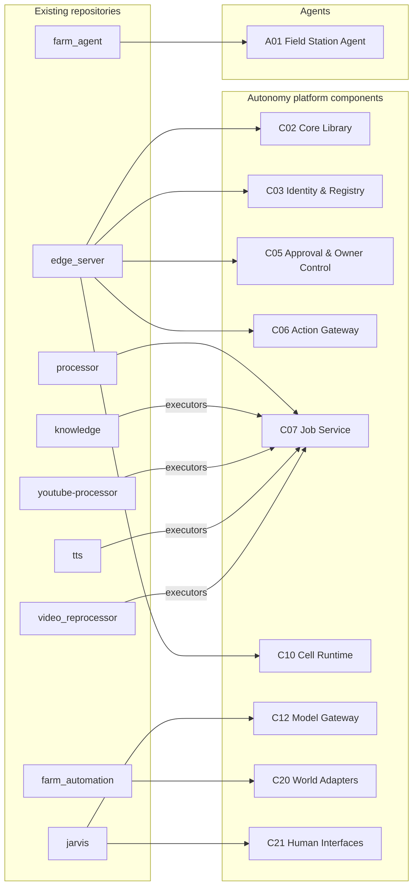

# Repository-to-Architecture Mapping

**Status:** Draft 0.1 · 2026-11-06 · Details and evidence: [current-state-inventory.md](current-state-inventory.md) · Component ids: [component-catalog.md](component-catalog.md)

## 1. Classification

| Repository | Classification | Target | Concrete reason | First change |
|---|---|---|---|---|
| `edge_server` | **Refactor into platform component** + **extract library** | C10 Cell Runtime; seed of C02, C05, C06 | Already has node keys, signed envelope, outbox, approvals design, tiers, power gating, CI and the largest test suite | Extract `controlplane.py` primitives into `autonomy-core` (C02) and make the bot core consume them; generalise `fleet.yaml` into the registry document (C03) |
| `processor` | **Refactor into platform component** | C07 Job Service | Working durable queue with leases, retries, DLQ, worker polling through NAT | Add idempotency key, `traceparent`, versioned job types, per-worker Ed25519 identity, component principals; add CI |
| `farm_agent` | **Refactor** (substantial) | A01 Field Station Agent | Right place (HA add-on) and idea; implementation has three defects and hard-coded scope | Fix tool loop, send system prompt, move HA access to the C20 adapter with allowlist from config, use C12 |
| `farm_automation` | **Reuse as-is** (deployment repo) | Field Station configuration (HA packages, Farm Core) | Design baseline v1.2 is consistent with Autonomy's safety layering | Implement Phases 1–3 as planned |
| `jarvis` | **Keep as independent application using Autonomy services** | C21 voice channel (P10) | Strong voice architecture; should not become a second control plane | Implement its `tools/` port as a C06 client; reuse its `LLMProvider` port as C12's interface |
| `knowledge` | **Keep independent**, **rename**, **extract executors** | P06; executors for C07 | It is a YouTube Q&A bot, not a knowledge store | Rename repo; expose transcript pipeline as `audio.transcribe` / `video.transcript` executors |
| `youtube-processor` | **Extract reusable service** | C07 executors `video.frames`, `vision.describe_frames` | Structured JSON output mode is directly usable as perception | Wrap `main.py` stages as executors with JSON Schema I/O |
| `tts` | **Extract reusable service** | C07 executor `tts.synthesize` | Working offline TTS | Wrap as executor; check upstream maintenance [A] |
| `video_reprocessor` | **Merge** | C07 executor `video.download`, `video.cut_compress` | Overlaps `youtube-processor`, `yt_sync` | Fold into one media executor package |
| `yt_sync` | **Keep independent** (later migrate to jobs) | P09 | Works on its own; its loop is a scheduled job | Optional: run as C07 scheduled job |
| `common_reflection` | **Keep independent** | P05 | Content production, consumes TTS and media executors | None required |
| `talk` | **Keep independent** | P08; optional notification channel later | Different, harder problem; too complex to be the platform bus | None; revisit as a C05 channel adapter |
| `leadgen` + `leadgen_front` | **Keep independent**; **merge** front into `leadgen` | P01 | Own customers, billing, data | Optionally use C12 and C07 for scoring jobs |
| `wildwatch` | **Keep independent** | P02 | Own customers, PostGIS, Stripe | Optional: publish hazard events for the owner's routes to C09 |
| `gardening-service` | **Keep independent** | P03 | Large dormant MVP; plant lifecycle domain | Optional future source of crop coefficients for A01 |
| `my_fin_structure` | **Keep independent, local-only** | P04 | Private financial data | Use C12 only with `privacy: local_only` routing |
| `tires`, `wires` | **Reuse as-is** (independent utilities) | P07 | Static calculators, no integration need | None; could be exposed as pure tools later |
| `my_vps` | **Reuse as-is** (ops scripts) | Hub host hardening | VPS that runs C07 control plane | Replace WireGuard client management with Tailscale where used for Autonomy |
| `fuel_economy` | **Archive** (or move into a perception experiments folder) | — | Two scripts, no README | — |
| `thequeue` | **Archive** | — | Dormant since 2025-06 | — |
| `hw` | **Archive / out of scope** | — | Unrelated bare-metal PoC | — |
| `basic-complexity`, `book`, `business_ideas` | **Out of scope** | — | No software | — |

No functioning software is recommended for rewrite. The two substantial refactors (`processor`, `edge_server`) extend existing code; `farm_agent` is small enough that a refactor touches most of its 352 lines.

## 2. Mapping diagram

## 3. Name changes recommended

| Current | Recommended | Why |
|---|---|---|
| `knowledge` repo | `youtube-answers` (or similar) | Frees "knowledge" for C15 and stops misleading readers |
| `processor` "control plane" | Keep, but call it the **Job Service** in Autonomy docs | Avoid confusion with the fleet control plane and the authority plane |

## 4. Not analysed in depth

Repositories last pushed before 2025 (`homeassistant`, `arduino`, `fridge_control`, `wifi-robot`, `ardzoom`, `terraform`, `aws`, `helm_package`, `wordpress`, `site`, `stud_python`, `test_proj`, `python_test_api`, `videodisck`, `x`, `terraform_tests`, `my_scripts`), forks, and the `airshipit` organisation. Default recommendation: archive the realsystem ones that are not deployed anywhere; `airshipit` is separate work.
