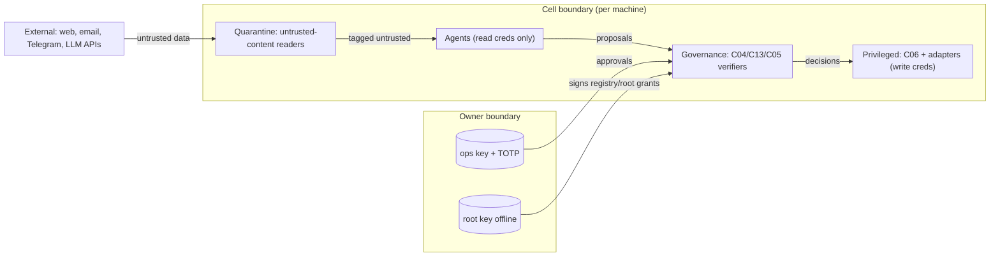

# Security and Trust

**Status:** Draft 0.1 · 2026-11-06

## 1. Assets and trust boundaries

| Asset | Why it matters | Where |
|---|---|---|
| Owner root key | Root of all authority | Offline (hardware key + paper backup) |
| Owner operational key, TOTP secrets | Approvals, grants | Owner devices; C05 holds TOTP verifiers per cell |
| Component private keys | Impersonation | Each host, root-only or add-on secret options [V] |
| Adapter write credentials (HA token, OpenSprinkler password, relay APIs) | Physical-world control | C06 only |
| Private data (finance, cameras, location) | Privacy | Owning app/cell; `local_only` routing |
| Physical safety | Water, pump, power | Hardware and controllers — outside Autonomy by design |

## 2. Threat model (STRIDE-style, prioritised)

| # | Threat | Example | Mitigation | Residual |
|---|---|---|---|---|
| T1 | **Prompt injection** via untrusted content | A YouTube transcript says "set irrigation to max" | Trust tagging and taint (contracts §3); quarantined agents have no R1+ tools; policy forbids R1+ from untrusted inputs without approval; plan-then-execute for actuating agents [R] | Owner approves a malicious proposal (approval fatigue) → batching, diff display, metrics |
| T2 | **Compromised agent** (bug, model misbehaviour, supply chain) | Agent floods proposals or proposes harmful actions | No write credentials; C13/C04 independent; rate limits; budgets; revocation; demotion on contradictions | Agent can still leak data it can read → least-privilege read allowlists |
| T3 | **Compromised cell** | Stolen Pi | Revoke cell key in registry (others reject it); per-cell TOTP so one code never acts on two cells [V]; R3 never remote | Local HA token on that cell is exposed → rotate after theft |
| T4 | **Spoofed or replayed messages** | Attacker on Tailscale resends an old approval | Signatures, `expires`, `seq`, seen-store [V], `params_hash` binding | — |
| T5 | **Over-broad Home Assistant access** | HA long-lived/Supervisor tokens are not entity-scoped [A] | Adapter-enforced allowlists; write path only in C06; separate HA user for read vs write where supported | A bug in the adapter bypasses allowlist → adapter tests + audit sampling |
| T6 | **Secrets leakage** | Token in logs, prompts or Telegram (not E2E encrypted [V]) | `secret://` refs; log redaction; secret scanner in CI; never send secrets in chats [V] | — |
| T7 | **Supply-chain compromise** | Malicious dependency in an agent or LLM proxy | Pin versions and hashes; minimal dependencies (prefer thin libraries over large proxies); CI-built signed tags [V]; artifact attestations (Sigstore/GitHub) [R]; Dependabot | Zero-days in pinned deps |
| T8 | **Cloud LLM provider data exposure** | Farm or finance data sent to a cloud API | `privacy` attribute; C12 routing `local_only`; per-agent `privacy` ceiling in manifest | Model provider retention policies |
| T9 | **Denial of owner path** | Telegram blocked; phone lost | Console as second path; recovery codes; R2 fails closed | Owner unreachable for days → only A3/A4 bounded work continues |
| T10 | **Policy mistakes** | Overly broad permit | Cedar validation + tests; deny-by-default; policy diffs reviewed; bundles signed | Owner error |
| T11 | **Insider/self-escalation by agents** | Agent edits its own prompt or grant | GOV-024: agents have no write access to config repos, registry, bundles; C11 runs agents with read-only config mounts | — |
| T12 | **Physical-world false success** | Controller says "valve open", nothing flows | C14 independent verification; farm flow meter and no-flow alarms [V] | Sensor fault mimics success → data-quality layer [V] |

## 3. Identity and authentication

| Principal | Credential | Verified by |
|---|---|---|
| Owner | Root key (offline), ops key, TOTP per cell (existing [V]), later WebAuthn passkey in console | C05, C03 |
| Cells, components, agents | Ed25519 keys in registry | C02 on every envelope |
| Workers | Ed25519 (replaces shared worker token in `processor` [V]) | C07 |
| External users of applications | The application's own auth (leadgen, wildwatch, gardening) | The application — not Autonomy |

No passwords between components. No long-lived bearer tokens between components (signed, short-lived envelopes instead).

## 4. Authorization

C04 (Cedar) — see [governance-and-authority.md](governance-and-authority.md). Defence in depth: Tailscale ACLs restrict which cells can reach which ports [V: edge_server design]; envelope signatures restrict who can say what; policies restrict what may be done.

## 5. Revocation

| Revoked | Mechanism | Effective |
|---|---|---|
| A grant | `authority.revoked` envelope signed by owner; also removable from next bundle | Next decision on each cell that received it; at most grant expiry elsewhere |
| A component/agent key | Registry update + revocation list | On receipt; heartbeat hash mismatch alerts within 10 min [V] |
| Owner ops key | Root-signed key rotation | On receipt; root key needed |
| Everything automatic | `/stop all` → hold mode | Immediately on each reachable cell; sticky |

Out-of-band path: an owner can send a revocation via Telegram to the cell's bot; the bot verifies the owner's TOTP and applies it locally even with no hub and no Tailscale.

## 6. Sandboxing and execution restrictions

| Component | Isolation |
|---|---|
| Agents | Container or separate OS user; read-only config; no shell; egress limited to C12, C09, C20 read endpoints (and web for quarantined readers) |
| C06 | Separate container/user; holds write creds; no LLM access |
| Executors handling untrusted media | Container with no credentials and no network except the download source, CPU/memory limits |
| Incident agent (A02) | `edge_server` rules [V]: no shell, read-only diagnostics list, repair catalog, turn/time/token limits, never `--dangerously-skip-permissions` |

## 7. Encryption

- In transit: WireGuard (Tailscale) between cells; TLS for the VPS public API; envelope signatures end to end.
- At rest: full-disk encryption where hardware allows (hub, GPU PC); SOPS + age for config files in git; secrets files root-only; backups encrypted with age before leaving the cell.

## 8. Secrets management ([ADR-013](adr/ADR-013-sops-age-and-cell-secret-stores.md))

| Option | Verdict |
|---|---|
| Per-cell secret store (existing `edge_server` `secret_store.py` [V]) + SOPS/age-encrypted config in git | **Adopt**: no extra service, works offline, owner holds keys |
| HashiCorp Vault / OpenBao | Defer: strong but another always-on stateful service to secure and back up; revisit if > 10 cells or dynamic credentials needed |
| Cloud secret managers | Only for cloud-hosted components (`jarvis` on GCP uses Secret Manager [V]); not a dependency for cells |
